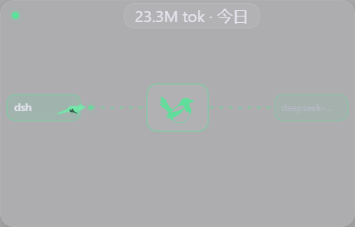

# Busy Bird

**鸟儿飞来飞去的 magpie 桌面挂件**

**A tiny transparent perch where a bird carries every magpie request.**

一张 300×190 的透明、无边框、可点击穿透的桌面小卡片。一张栖息着一只小喜鹊：magpie 里每出现一个请求，就有一只戴着该 Agent 颜色的鸟儿从左侧 Agent 出发，穿过中间的 magpie 栖木，飞到右边的账号上等待回答，再把结果带回 Agent。空闲时，栖木上的喜鹊会蹦一蹦、抖抖翅膀。

<p align="center">
  
</p>

[](#)
[](https://www.electronjs.org/)
[](./LICENSE)

## 它从哪来

这是 [yimi1mi/busy-magpie](https://github.com/yimi1mi/busy-magpie) 的缩小致敬版：飞的还是那只喜鹊（同一套 SVG 与飞行曲线，MIT 授权），但卡片从 632×432 缩到 300×190，只留下最喜欢的那件事——**鸟儿飞来飞去**。

- **一只请求一只鸟**：每个进行中的请求是一只 Courier，翅膀 0.42s 一拍，沿贝塞尔丝线滑行，转弯时压坡度。
- **等在账号边**：请求进行中，鸟儿悬停在账号卡片旁等结果；改道时会先飞回 magpie 再转向下一个账号；失败时驮着红点返回。
- **穿过 magpie 有一圈涟漪**，Agent、连线、鸟、涟漪用同一个品牌色。
- **空闲的生命感**：没有请求时，栖木上的喜鹊随机蹦跳、抖翅、左右张望；断线时它会打瞌睡（变暗）。
- **顶部 token 胶囊**：读取 `/v1/magpie/usage`，单击在 今日 / 7 天 / 30 天 / 全部 之间循环。
- **透明、置顶、点击穿透**：只有顶部 26px 的拖动条和胶囊接收鼠标，其余点击落到下层窗口。

## 安装

### 作为 magpie 插件（启动器）

```bash
magpie plugin add github:chaofanat/busy-bird
```

插件是启动器：magpie 第一次用到它会自动拉起桌面挂件。挂件本体需要在本地能找到，查找顺序：

1. `BUSY_BIRD_APP` 环境变量指向的可执行文件
2. `%LOCALAPPDATA%\Programs\Busy Bird\Busy Bird.exe`（安装版）
3. 插件目录内 `npm install` 过的 Electron 开发副本

### 直接运行源码

需要 Node.js 20+，以及本机正在运行的 magpie（默认 `127.0.0.1:3425`）。

```bash
npm install
npm start
```

启动后没有任务栏窗口，只有桌面卡片和托盘图标。

### 不想连真 magpie？用模拟器看效果

```bash
npm run mock            # 在 127.0.0.1:3529 模拟 trace / usage
# 另开一个终端
BUSY_BIRD_GATEWAY=http://127.0.0.1:3529 npm start
```

或者让挂件自己给自己造数据（不联网）：

```bash
npm run shot            # --demo + 截图到 docs/screenshots/bird.png
```

## 交互

- **拖动**：按住卡片顶部 26px 的条拖到任意位置；松手恢复点击穿透。
- **token 胶囊**：单击切换时间窗；悬停显示输入 / 输出 / 缓存明细。
- **托盘菜单**：显示 / 隐藏、总在最前、时间窗、退出。
- **位置记忆**：位置写进 `%APPDATA%\Busy Bird\settings.json`，重启保持。

## 它是怎么工作的

```text
magpie 本机网关 (:3425)
   │  GET /v1/magpie/trace   (long poll, 增量合并)
   │  GET /v1/magpie/usage   (按时间窗)
   ▼
Electron 主进程 (src/main.js)
   │  IPC
   ▼
透明 BrowserWindow (web/)
   ├─ wires: Agent ┈┈┈ magpie ┈┈┈ 账号 的丝线
   ├─ birds: 每个请求一只 Courier（SVG + getPointAtLength 逐帧飞行）
   └─ perch: 空闲时栖息在 magpie 栖木上的喜鹊
```

- trace 的 `after=seq` 只返回变化的路由，主进程维护合并表；网关重启（pid 变化）后自动清屏重取。
- 长轮询失败按 1s / 2s / 4s / 5s 退避重试，每次重试都重新解析网关地址；左上角圆点变琥珀色。
- 渲染层没有 Node 权限；trace 与 usage 只读本机，不发送任何数据到外部。

## 项目结构

```text
plugin/launch.hooks.mjs  magpie 启动器插件（magpie.hooks 入口）
plugin/server.mjs        空 provider stub
src/main.js              窗口、托盘、长轮询、usage、拖动、保活心跳
src/preload.js           contextBridge 白名单
web/index.html           卡片结构
web/app.js               舞台渲染、飞行状态机、栖息闲置动画、胶囊
web/flight-path.mjs      贝塞尔丝线与缓动（取自 busy-magpie）
web/magpie-path.mjs      喜鹊剪影路径（取自 busy-magpie）
web/styles.css           透明卡片、扇翅、涟漪、闲置动作
tools/mock-server.mjs    本地模拟 trace / usage
assets/icon.png          托盘图标
```

## 已知限制

- 只展示本机 magpie 网关；窗口固定 300×190，不缩放。
- 主视图最多 3 条泳道，更多请求分组时共用最下面一条。
- 穿过动效只有涟漪一种（原版还有漩涡 / 溶解 / 电弧）。
- 系统开启「减少动态效果」时停止扇翅与流动虚线，但鸟仍会移动。

## 致谢

- [yimi1mi/busy-magpie](https://github.com/yimi1mi/busy-magpie)：喜鹊 SVG、飞行曲线、回放模型与整体灵感，MIT 授权。

## License

[MIT](./LICENSE)
